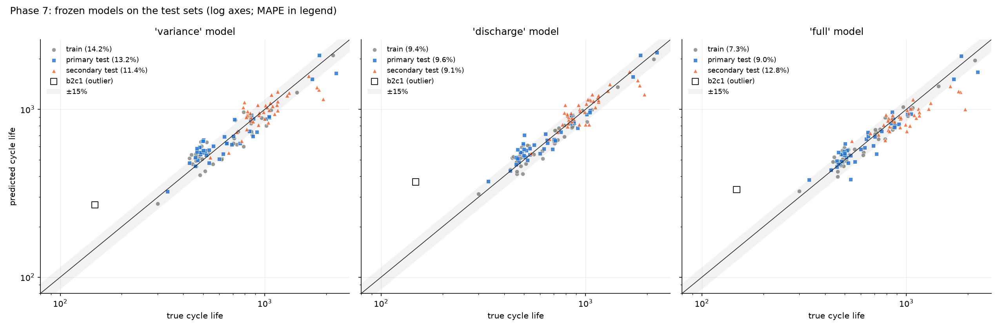
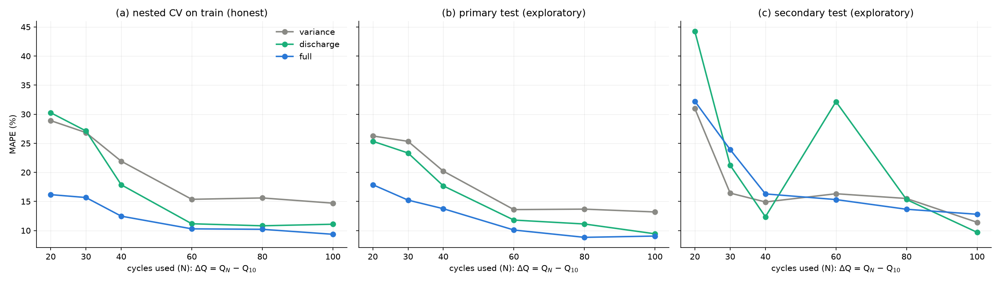

# cellspan

Predicting how long a battery cell will last from its first 100 cycles.

Reproducing the 2019 paper "Data-driven prediction of battery cycle life before
capacity degradation" (Nature Energy 4, 383-391,
[doi:10.1038/s41560-019-0356-8](https://doi.org/10.1038/s41560-019-0356-8)).

124 LFP/graphite cells (A123 APR18650M1A) were fast-charged until they dropped to 80% of
their capacity. Lifetimes range from 148 to 2237 cycles. The goal is to predict a cell's
lifetime using only its first 100 cycles, when capacity has barely moved.

It works to about 9-10% error. The main signal is how the shape of the discharge curve
changes between cycle 10 and cycle 100 (variance of ΔQ100-10(V)).



## Results

Mean percent error on each set, mine / paper (Table 1):

| model | features | train | primary test | secondary test |
|---|---|---|---|---|
| variance | log var ΔQ(V) | 14.2 / 14.1 | 13.2 / 13.2 | 11.4 / 11.4 |
| discharge | 6 ΔQ and capacity features | 9.4 / 9.8 | 9.6 / 10.1 | 9.1 / 8.6 |
| full | 9 features incl. charge time, temp, resistance | 7.3 / 5.6 | 9.0 / 7.5 | 12.8 / 10.7 |

Primary test excludes the outlier cell b2c1 (148 cycles), same as the paper. With it:
14.8 / 12.9 / 11.7. RMSE numbers are in the log (Phase 7).

Notes:
- The variance model matches the paper exactly, so the data loading, split and main feature
  are right. The full model is a bit worse than theirs. Probably differences in
  hyperparameter search and feature cleaning that the paper doesn't spell out.
- The models were frozen before I looked at the test sets. Cross-validation on the training
  set guessed 9.3% for the full model; the test came out at 9.0%.
- On the secondary test (a later batch with different charging protocols) the full model gets
  worse. Some of its features (initial capacity, charge time) partly just encode which batch
  a cell is from. The paper has the same issue.

Extras I added:
- Short vs long life classifier (under 550 cycles?) from the first 5 cycles: 90.7% on the
  primary test, 95.0% on secondary (paper: 92.7 / 97.5). Batch 3 only has one short-lived
  cell, so the secondary number doesn't mean much.
- How many cycles you actually need: ΔQ is useless at 20 cycles, gets much better up to
  about 60, then levels off around 10% error.



## Setup

Python 3.11. You need about 12 GB free for the data.

```bash
python3.11 -m venv .venv
.venv/bin/pip install -r requirements.txt
```

Download the three batch files from
[data.matr.io](https://data.matr.io/1/projects/5c48dd2bc625d700019f3204) into `data/raw/`:

- `2017-05-12_batchdata_updated_struct_errorcorrect.mat`
- `2017-06-30_batchdata_updated_struct_errorcorrect.mat`
- `2018-04-12_batchdata_updated_struct_errorcorrect.mat`

Then convert them:

```bash
.venv/bin/python -m src.convert
```

## Running

Run the scripts in `notebooks/` in order, from the repo root:

```bash
.venv/bin/python notebooks/01_data_structure.py
```

- `01_data_structure.py` - what one cell's data looks like
- `02_exploration.py` - capacity curves, lifetimes, anomalies
- `03_split.py` - train / primary test / secondary test split
- `04_features.py` - builds `data/processed/features.csv`
- `05_baseline.py` - baselines
- `06_models.py` - fits and saves the ElasticNet models
- `06_nested_cv.py` - nested CV, ElasticNet vs plain linear regression (~12 min)
- `07_evaluate.py` - test set results
- `08_classifier.py` - 5-cycle classifier
- `08_earliness.py` - error vs number of cycles used (~12 min)
- `08_earliness_diagnosis.py` - why one model breaks on batch 3 at 60 cycles

They have `# %%` cell markers so you can also open them as notebooks in VS Code.

Tests:

```bash
.venv/bin/python -m pytest
```

Tests that need the dataset get skipped if you haven't downloaded it.

## Layout

```
src/data.py        loads the batches, joins cells that continued into batch 2, drops bad ones (124 left)
src/convert.py     converts the .mat files to pickles
src/split.py       target (log10 life) and the paper's split
src/features.py    features from the first 100 cycles, refuses anything later
src/evaluate.py    RMSE and MAPE in cycles
src/models.py      ElasticNet and logistic regression pipelines
notebooks/         one script per step
tests/             tests
figures/           plots
```

## Things I didn't do

- prediction intervals instead of single numbers
- non-linear models (random forest, boosting)
- features that hold up better across charging protocols

## License

Code is MIT (see `LICENSE`). The data isn't in this repo; it's CC BY 4.0 from
[data.matr.io](https://data.matr.io/1/projects/5c48dd2bc625d700019f3204), and the plots in
`figures/` are made from it.

If you use this, cite the original paper
([doi:10.1038/s41560-019-0356-8](https://doi.org/10.1038/s41560-019-0356-8)).

All code here is my own. Which cells make up the paper's 124-cell set comes from the paper;
`src/data.py` works most of it out from the data itself (see the comments there).
